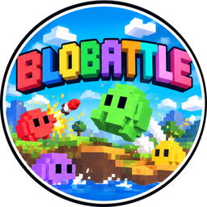

# Blobattle

<p align="center"></p>

Artillerie au tour par tour entre blobs de gélatine en voxels, dans l'esprit de Worms : de 2 à 8
équipes, un terrain qui se creuse voxel par voxel, des bots sur les places libres. Pensé pour le
téléphone en paysage, joué par un lien dans le navigateur ou en APK Android (au run E).

Lua de bout en bout : un client **Defold**, un serveur **Nakama** (runtime Lua), et une simulation
en Lua pur, déterministe au bit près, exécutée telle quelle par les deux (voir
`docs/adr-001-defold-lua.md`).

## Ce qui existe

| Run | Contenu | État |
|---|---|---|
| A | la simulation, les bots, le banc, la conformité sous LuaJIT, Lua 5.1 et Nakama | fait |
| B | le serveur : salon, partie, absences, snapshots, revanche, harnais Node | fait |
| C | le client hors ligne : cartes, rendu en voxels, commandes aux pouces et au clavier, écrans, parcours dans Chromium | fait |
| C2 | la jauge de déplacement et le tentacule (grappin à balancier) | fait |
| C3 | les chocs entre blobs, l'uppercut, le Chomp, la forêt et le volcan, la lave qui monte | fait |
| C4 | des poutrelles partout au volcan, l'intro Panis Vult ; les bots qui jouent tout (tranches 24j à 24m) restent à faire | en partie |
| C5 | le séisme de la forêt dès la 8e ronde (secousses, failles jusqu'à l'eau), une croix ◀ ▶ ▲ ▼ et un bouton Jump au doigt | fait |
| C6 | la dynamite, qu'on pose et qui explose 5 s plus tard, et des munitions comptées par partie | fait |
| C7 | les touches du clavier au choix (écran Keys), gardées sur l'appareil | fait |
| C8 | les caisses parachutées et leurs quatre armes : Waddler, jetpack, grappe, appui aérien | fait |
| D | la partie en ligne par code sur le réseau local : Multi, Salon, synchronisation vérifiée, lignes des équipes, absences et reconnexion, revanche | fait |
| D2 | le tunnel Cloudflare et nginx : le jeu sur **https://blobattle.npc.fm** ; restent la PWA et la limite de `room_create` | en partie |
| D3 | le panneau d'administration local : parties en cours et terminées, équipes, résultats | à venir |
| E | Android, finitions, clôture de la V0 | à venir |

Aujourd'hui, on joue contre les bots (écran Solo), ou en ligne entre téléphones et ordinateurs du
réseau local (écran Multi) : l'un crée un salon et partage son lien ou son code, les autres le
rejoignent, l'hôte règle la partie et lance. Hors du réseau local, on joue par le tunnel, sur
**https://blobattle.npc.fm**.

**Pour l'installer sur sa propre machine** (réseau local, VPS, avec ou sans tunnel), tout en
conteneurs : **[`docs/heberger.md`](docs/heberger.md)**. Pour le faire faire par un agent IA (Claude
Code, Codex…), lui demander de suivre **[`IA.md`](IA.md)**.

### Le jeu

- **Blobs** : 100 PV, une jauge de déplacement par tour (marcher et sauter la vident), une tolérance
  de 2 px en l'air. Un blob projeté qui en touche un autre le projette à son tour ; ceux qui marchent
  se croisent.
- **Armes** :
  - **Bazooka** : sensible au vent, explose à l'impact.
  - **Grenade** : minuterie de 1 à 5 s, rebondit.
  - **Tentacule** : un grappin à balancier. Il ne termine pas le tour ; on y grimpe, on s'y balance,
    et un saut le lâche avec de l'élan.
  - **Uppercut** : au contact, envoie le blob d'en face en l'air en cloche (30 dégâts, plus la
    chute).
  - **Chomp** : le blob mange la terre et creuse un tunnel à sa taille, dans la direction visée,
    pendant 2 s.
  - **Dynamite** : un bâton rouge posé aux pieds du blob, dont la mèche crépite 5 s avant
    l'explosion (rayon 30 px, 75 dégâts, mortelle avec la chute). La pose remplit la jauge : on a les
    5 s pour s'éloigner.
  - **Grappe** (caisses) : lancée comme la grenade, avec la même minuterie ; elle explose et lâche
    cinq mini-blobs de couleur qui explosent au contact.
  - **Appui aérien** (caisses) : on pose une cible sur la carte, un avion lâche cinq obus en ligne
    autour d'elle.
  - **Waddler** (caisses) : un mini-blob blanc qui marche seul et saute les obstacles ; on le fait
    exploser quand on veut (70 dégâts), sinon il explose seul au bout de 10 s.
  - **Jetpack** (caisses) : 5 s de carburant pour voler. Il ne termine pas le tour.
- **Munitions**, par équipe et par partie : bazooka 10, grenade 10, Chomp 3, dynamite 1 ; tentacule
  et uppercut sans limite ; les quatre armes des caisses, une par caisse ramassée. Une arme épuisée
  quitte la grille. Les seuils sont dans une seule table,
  `rules.AMMO` (`shared/sim/rules.lua`), pour tout le jeu ; en changer un ré-enregistre les vecteurs
  (`make vectors`, voir SPEC §8.2).
- **Cartes** (réglage « Map » : Forest, Volcano, Random) :
  - **forêt** : collines d'herbe, de terre et de roche, surplombs, cavernes, arbres, eau qui ne monte
    pas, nuages, et **dès la fin de la 8e ronde, un séisme à chaque fin de ronde**, de plus en plus
    fort : trois secousses qui soulèvent les blobs, une faille nouvelle jusqu'à l'eau et les
    anciennes qui s'écartent ;
  - **volcan** : cendre et basalte sous un ciel rougeoyant, grottes plus grandes, stalactites,
    poutrelles d'acier (on peut apparaître dessus), brume et bulles sur la lave, et une lave qui
    **monte de 2 px à la fin de chaque ronde**.
- **Tours** : 45 s par défaut, 3 s de repli après un tir (5 s après la dynamite), 30 rondes au plus.

### Commandes

| | Au doigt (téléphone) | Au clavier et à la souris |
|---|---|---|
| marcher | ◀ ▶ de la croix, au pouce gauche, maintenus | ← → |
| sauter | le bouton Jump, au pouce droit, à côté du bouton d'arme | Entrée |
| viser et tirer | lance-pierre depuis le blob : tirer vers l'arrière, relâcher | ↑ ↓ pour l'angle, Espace maintenu pour la puissance ; ou glisser à la souris vers la cible |
| choisir l'arme | le bouton d'arme ouvre la grille (jusqu'à dix cases) | 1 à 9, 0 |
| minuterie de la grenade | la pastille au-dessus du bouton d'arme | F |
| tentacule accroché | ◀ ▶ balancent, ▲ ▼ de la croix (grisés tant qu'on n'est pas accroché) raccourcissent ou allongent la corde, Jump lâche | ← → balancent, ↑ ↓ pour la corde, Entrée lâche |
| appui aérien (caisses) | un appui sur la carte pose la cible, Strike lâche les obus | un clic sur la carte, puis Espace ou Strike |
| Waddler (caisses) | posé comme la dynamite ; Boom le fait sauter | Espace le pose, Espace ou Boom le fait sauter |
| jetpack (caisses) | ▲ pousse vers le haut, ◀ ▶ de côté, Jump coupe le moteur | ↑, ← →, Entrée |
| caméra | glisser ailleurs pour déplacer, pincer pour zoomer, double appui pour recentrer | molette, clic droit glissé |

Les touches du clavier ci-dessus sont celles par défaut. Chacune se change à l'écran **Keys**, ouvert
depuis l'Accueil sur ordinateur : un clic sur la touche d'une commande, puis la touche voulue (Échap
annule, une touche déjà prise s'échange, **Default** remet tout). Le choix est gardé sur l'appareil,
comme le profil, rechargement compris.

Un tour sur trois, un avion lâche une caisse qui descend en parachute ; le blob qui joue la ramasse
en la touchant et son équipe gagne une arme qu'on ne trouve que là : la grappe, l'appui aérien, le
Waddler (un mini-blob qui marche seul) ou le jetpack.

## Lancer le jeu

Il faut **Docker** (tout tourne dans des conteneurs) et Internet pour le premier build Defold (les
extensions natives se compilent sur le serveur de build de Defold).

```sh
cp .env.example .env   # à remplir : UID/GID et six clés aléatoires (docs/heberger.md, §1)
make tools             # l'image d'outils : Defold (bob.jar), LuaJIT, Lua 5.1, busted, Node, Chromium
make web               # le build HTML5 dans out/web/Blobattle
make serve             # le sert sur le réseau local, au premier plan : http://<ip-de-la-machine>:5373/
```

Sur le téléphone, ouvrir l'adresse servie, en paysage : après l'intro (le studio Panis Vult, puis le
logo du jeu ; un appui la passe), **Solo** pour une partie contre les bots, **Multi** pour jouer en
ligne : **Create a room** donne un code de 5 lettres et un bouton de partage (le lien `?room=CODE`
ouvre le Salon), **Join** prend le code. Le jeu en ligne a besoin de Nakama sur la même machine :

```sh
make up                # Postgres et Nakama, puis une vérification
make down
```

Le client trouve Nakama à l'adresse de la page, port 7550 (en `https:`, à l'origine même de la
page) ; `make web` y met la clé serveur de `.env`.

Pour servir le jeu pour de bon, avec nginx et des conteneurs relancés avec la machine, voir
**`docs/heberger.md`** :

- `make site` en http ;
- `make https` en https, avec un Caddy en conteneur et un certificat automatique, pour un VPS ;
- `make tunnel` par un tunnel Cloudflare ;
- ou `make site` derrière son propre reverse proxy.

C'est par le tunnel Cloudflare `blobattle` que tourne **https://blobattle.npc.fm** (ses identifiants
et `config.yml` dans `./cloudflared/`, ignoré par git ; modèle dans `tools/tunnel/config.example.yml`) :

```sh
make up web tunnel     # Nakama, le build, puis nginx et cloudflared (profil Compose `tunnel`)
make tunnel-down
```

Le jeu est alors sur **https://blobattle.npc.fm** : le tunnel envoie `/v2/`, `/ws` et
`/healthcheck` à Nakama et tout le reste au nginx qui sert `out/web/Blobattle` ; la console Nakama et
Postgres restent en local. `make journey` et `make harness` redémarrent Nakama : une partie en cours,
même par le tunnel, tombe. Avec `?test=1`, une ligne en bas de l'écran donne l'aller-retour d'une entrée, le temps de la
dernière reconnexion et la taille du dernier snapshot.

Ports : **5373** (`make serve`), **5380** (nginx, en local par défaut : `WEB_BIND`), **7550** (API et
socket Nakama), **7551** (console Nakama, en local), **5438** (Postgres, en local) ; **80** et **443**
avec `make https`.

## Développer

| Commande | Ce qu'elle fait |
|---|---|
| `make test` | la suite busted sous LuaJIT **et** Lua 5.1 |
| `make lint` / `make fmt` | luacheck et StyLua (scripts Defold compris) |
| `make conformance` | les vecteurs de conformité : mêmes sommes sous LuaJIT, Lua 5.1 et Nakama |
| `make vectors` | ré-enregistre les vecteurs (un commit dit pourquoi) |
| `make harness` | le harnais Node contre un vrai Nakama : salon, parties, reconnexion, charge, armes en ligne |
| `make journey` | le parcours : le build HTML5 joué dans Chromium par CDP, au doigt et au clavier, puis en ligne à plusieurs contextes contre Nakama (`J=offline` ou `J=online` pour une seule partie, `J=quake` pour le seul séisme en ligne, que `J=online` joue aussi, `J=dynamite` pour la seule dynamite, `J=keys` pour le seul écran des touches, `J=crates` pour les seules caisses, que `J=offline` jouent aussi) |
| `make bench N=200` | le banc : 200 parties entre bots, statistiques de durée et de dégâts |
| `make perf` / `make sweep` | les mesures de coût et le balayage de 200 graines de cartes |
| `make trig` | régénère la table trigonométrique |

Chaque changement suit le même cycle (`docs/conventions.md`) : la spec d'abord si une décision
change, le test vu rouge, le code, la vérification réelle (banc, conformité, harnais, parcours), le
commit en français.

### Le dépôt

| Chemin | Ce qu'il contient |
|---|---|
| `shared/sim/` | la simulation : carte, blobs, projectiles, armes, tours, somme de contrôle, snapshot |
| `shared/bots/` | le cerveau des bots |
| `shared/protocol.lua` | les messages et leur validation |
| `server/` | le match Nakama `room` et ses RPC |
| `client/` | Defold : autorité, rendu, caméra, commandes, écrans, textes |
| `spec/` | les tests busted, fichier par fichier, et les vecteurs de conformité |
| `tools/` | banc, harnais, parcours, conformité, image Docker |
| `docs/` | l'ADR, les conventions, la sonde, la planche des cartes, le fichier de chaque run |

**Le déterminisme** (D-02) tient tout : dans `shared/`, des entiers seulement (256 unités par pixel),
une table trigonométrique figée, des arrondis symétriques, aucun `pairs`, aucune horloge. Le serveur
fait autorité ; chaque client rejoue les mêmes entrées aux mêmes ticks et vérifie les sommes.

## Documents

| Document | Ce qu'il dit |
|---|---|
| `SPEC.md` | le jeu, les décisions D-01…D-15, le plan TDD |
| `V0.md` | quand la V0 est finie, et comment conduire les runs |
| `CLAUDE.md` | les règles d'écriture du code |
| `docs/conventions.md` | comment un changement traverse le dépôt |
| `docs/heberger.md` | installer le jeu sur sa propre machine, en conteneurs, avec ou sans tunnel |
| `IA.md` | la même installation, étape par étape, pour un agent IA |
| `docs/adr-001-defold-lua.md` | pourquoi cette stack |
| `docs/runs/` | le prompt et le bilan de chaque run |
| `docs/sonde/`, `docs/sonde-voxel/` | les sondes de faisabilité qui ont précédé la spec |
| `docs/planche_maps_worms_like.pdf` | la planche de référence des cartes |

## Crédits

Logo du jeu (`client/brand/`, découpé dans `logo-base.png`, fourni à côté du dépôt), logo du studio Panis Vult (`client/brand/intro_studio.png`, réduit de
`panisvult.png`) et planche des cartes : fournis pour le projet. Tout le reste du rendu
(terrain, blobs, décors) est généré par le code ; la police est Fredoka One (OFL).
