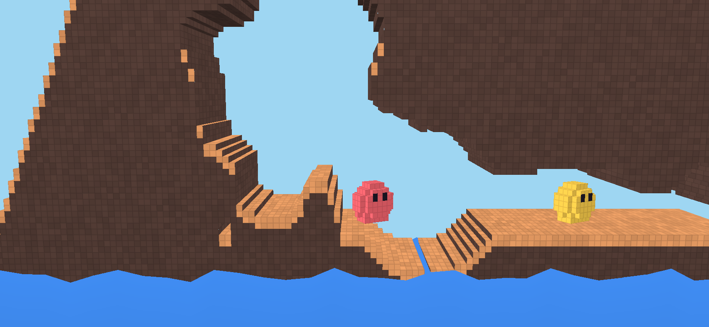

# Sonde voxel

Prototype jetable mené après le run B pour trancher Q-04 (le style de rendu). L'utilisateur a choisi
la **3D en voxels** : terrain destructible voxel par voxel et « chats » dessinés en blobs gélatineux.
Le code de `ref/` **n'est pas du code produit** : il sert de référence au run C. Le prototype complet
tournait dans un dossier à côté du dépôt, avec la vraie sim reliée par un
lien symbolique et les bots jouant toutes les équipes.

## Ce qui a été construit

- **Terrain** : une cellule pleine de la sim = un voxel, extrudé sur 20 unités de profondeur ; seules
  les faces qui touchent l'air existent (faces avant par plages, dessus, dessous, côtés par plages
  verticales). Maillage par morceaux de 32 colonnes, chacun gardant sa géométrie **par rangée** (avant,
  dessus, dessous) et **par colonne** (côtés) dans de petits buffers Defold. Après un cratère, seules
  les rangées `[y − r − 1, y + r + 2]` et les colonnes `[x − r − 1, x + r + 1]` des morceaux touchés
  sont recalculées ; le buffer du morceau se réassemble par `buffer.copy_stream` (copie en C), puis
  `resource.set_buffer`.
- **Étalement** : les rangées et colonnes sales se recalculent dans un budget par image (2 ms), et un
  morceau n'est renvoyé au GPU qu'une fois complet : le flash de l'explosion (0,24 s) couvre la zone
  pendant ce temps.
- **Couleurs dans le shader**, sans flux de couleur : la normale dit le genre de face (avant, dessus,
  dessous, côté) ; une normale avant à peine inclinée (`0, 0.05, 0.9987`) marque la bande de liseré ;
  le dégradé de la terre vient de la hauteur ; variation de teinte par voxel (hachage de la cellule)
  et quadrillage adouci par `fwidth`, qui s'efface quand on dézoome.
- **Blobs** : un ellipsoïde d'environ 7 × 7 × 5 voxels (la boîte de collision de la sim fait 6 × 7)
  plus deux voxels d'yeux, teinte d'équipe par constante. Shader gélatineux piloté par deux
  constantes : `squash` (échelles horizontale et verticale autour de la base, penchement) et `wobble`
  (amplitude et phase d'une ondulation). Un ressort côté Lua les anime à partir des événements de la
  sim : `landed` écrase, un saut étire, `damaged` fait trembler, `fired` rebondit, `died` aplatit en
  flaque grise. Les blobs tournent de ±0,5 rad vers leur direction.
- **Explosions** : un cube lumineux qui grossit et 14 petits cubes de terre projetés, en balistique
  simple côté rendu.
- **Liquide** : un volume sous `L`, surface ondulée par le shader.

## Mesures

Build HTML5 release de Defold 1.13.1, Chromium 153 sans interface, vue 844 × 390 à DPR 2, carte 4 × 4
(graine 4242), `?bench=1` : 60 cratères de rayon 12 creusés à la suite puis reconstruits sans budget.
**Le GPU était SwiftShader, un rendu logiciel** : les images par seconde ci-dessous ne disent rien
d'un téléphone (H-11) ; seules les durées côté CPU comptent.

| Mesure | CPU ×1 | CPU ×4 |
|---|---|---|
| Construction de toute la carte (32 morceaux) | 166 ms | 1,3 s |
| Reconstruction d'un cratère, sans budget | 5,1 ms en moyenne, 9 au pire | 39 ms en moyenne, 70 au pire |
| Tranche de reconstruction par image (budget 2 ms) | 2,3 ms, 3 au pire | 2,5 ms, 4 au pire |
| Images par seconde (GPU logiciel) | 60 | 60, 17,3 ms au p95 |
| Tick de sim avec les bots hors ligne (1 000 unités) | 0,3 ms | 1,35 ms, **11 ms au p95** |
| Sommets du terrain | 25 800 | |

Le chemin vers ces chiffres, reconstruction d'un cratère à CPU ×1 :

| Version | ms par cratère |
|---|---|
| Voxels, maillage complet du morceau à chaque cratère, flux de couleur | 30 à 34 |
| Lissé (marching squares), cache par rangée | 14 à 17 |
| Lissé, buffers par rangée assemblés par `copy_stream` | 9,5 |
| Lissé, sans flux de couleur, échantillons bornés au morceau | 7,5 |
| **Voxels, cache par rangée et par colonne, sans couleur** | **5,1** |

Un profil de la version lissée donnait 8,7 ms de calcul des rangées en Lua, contre 0,55 ms
d'assemblage et 0,27 ms d'envoi au GPU : le coût est dans le Lua et dans les écritures élément par
élément dans les buffers, pas dans le GPU.

## Pièges

- **Le buffer placeholder d'un composant `mesh` fixe son format de sommets** : un buffer mis à
  l'exécution qui n'a pas exactement les mêmes flux (même noms, mêmes tailles) est lu de travers —
  d'immenses triangles et des pointes. Ici le placeholder avait un flux `color` que les buffers
  n'avaient plus.
- **Écrire un buffer élément par élément coûte cher en HTML5** (un appel Lua → C par valeur) : garder
  des buffers par rangée et les assembler par `buffer.copy_stream`, et ne pas porter de couleur par
  sommet quand le shader peut la déduire.
- **`buffer` n'a pas d'écriture en bloc** depuis Lua (ni `set_bytes`) : seulement `copy_stream` et
  `copy_buffer`.
- **Defold normalise les normales d'un maillage en espace monde** : une normale nulle devient NaN.
- **Le script de rendu par défaut suffit** : il dessine le prédicat `model` avec test de profondeur et
  élimination des faces arrière, et suit un composant caméra. Les faces doivent être dans le sens
  inverse des aiguilles d'une montre vues de l'extérieur.
- **`[mesh] max_count`** vaut 128 par défaut : 32 morceaux, 48 blobs à deux maillages, les projectiles
  et les débris le dépassent ; le prototype le met à 512.
- **Le budget des bots hors ligne (1 000 unités de travail par tick) est trop gros pour HTML5** : 11 ms
  au p95 à CPU ×4. À régler au run C sur la mesure dans le build HTML5.
- **Trier des séries de mesures à chaque image** coûte assez pour fausser les images par seconde : ne
  calculer les statistiques qu'une fois par seconde.

## Fichiers de référence

| Fichier | Ce qu'il montre |
|---|---|
| `ref/client/main/mesher.lua` | le maillage voxel par morceaux, avec cache par rangée et par colonne |
| `ref/client/main/mesher_smooth.lua` | la version lissée (marching squares), écartée pour le voxel |
| `ref/client/main/voxel.lua` | le blob, ses yeux et le cube, en voxels |
| `ref/client/main/world.script` | la boucle : sim et bots, reconstruction étalée, ressort des blobs, débris, caméra, mesures publiées dans `window.proto` |
| `ref/client/main/*.vp`, `*.fp`, `*.material` | shaders du terrain (voxels et liseré), des blobs (gélatine, bords de voxels) et du liquide |
| `ref/client/main/*.go`, `main.collection`, `ref/client/game.project` | objets, collection et réglages (`[mesh] max_count = 512`) |
| `ref/tools/cdp.mjs`, `ref/tools/serve.mjs` | pilote CDP (mesures, captures) et serveur statique |

Paramètres de l'URL du prototype : `seed`, `teams`, `cats`, `liquid`, `zoom` (165 par défaut, 95 pour
un gros plan), `budget` (ms par image), `bench=1`, `hud=0`.
